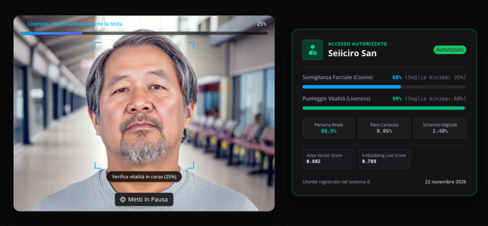
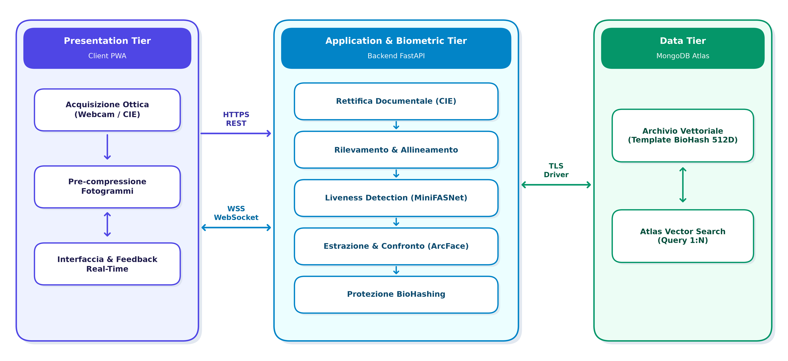

# Progettazione e sviluppo di un sistema di Autenticazione Biometrica Facciale mediante CIE e tecniche ANTI-SPOOFING
Sistema client-server che autentica un utente confrontando il volto ripreso dalla webcam con la fototessera della **Carta d'Identità Elettronica (CIE)**. Prima del confronto, una **liveness detection** passiva verifica che davanti alla fotocamera ci sia una persona reale e non una foto o uno schermo.

Progetto della tesi di laurea triennale in Ingegneria Informatica (Politecnico di Bari) di Jonathan Caputo. 
La tesi completa è in [`Tesi/main.pdf`](Tesi/main.pdf).



## Come funziona
- *Registrazione* L'utente fotografa il fronte della CIE. Il backend rettifica il documento (prospettiva e contrasto CLAHE), estrae il volto e ne calcola l'embedding a 512 dimensioni.
- *Login* in tempo reale. Il browser invia i fotogrammi via WebSocket. Il server rileva il volto, accumula un buffer di punteggi di vitalità (_MiniFASNet_) e controlla che l'utente non sia un'immagine statica.
- *Riconoscimento* Superata la liveness, l'embedding del volto viene cercato nel database con MongoDB Atlas Vector Search (similarità coseno) e confrontato con la soglia configurata.

Su registrazioni reali, il sistema raggiunge un EER del 4,8% con circa 14ms di elaborazione per fotogramma.



## Stack

| Livello | Tecnologie |
|---|---|
| Frontend | React 19, React Router 8 (SPA), HeroUI, Tailwind CSS 4, Vite 8 |
| Backend | Python, FastAPI, Uvicorn (REST + WebSocket) |
| Biometria | InsightFace `buffalo_l`, MiniFASNetV2 su ONNX Runtime, OpenCV |
| Database | MongoDB Atlas con Vector Search (coseno, 512 dimensioni) |

## Come avviarlo
1. Crea una cartella in ```\backend\.insightface``` e carica il modello ```MiniFasNet_v2.onnx_``` scaricandolo da [InsightFace](https://huggingface.co/garciafido/minifasnet-v2-anti-spoofing-onnx)

2. Crea un cluster MongoDB Atlas con un database (es. `authcie`) e sulla collection `users`. Crea un indice *Vector Search* chiamato `vector_index` con questi parametri:
  ```json
  {
    "fields": [
      { "type": "vector", "path": "embedding", "numDimensions": 512, "similarity": "cosine" }
    ]
  }
  ```
 >In alternativa avvia l'immagine Docker e l'indice viene creato da solo al primo avvio.

3. Configura i parametri nel file ```.env```

4. Avvia il *backend*
```bash
python3 -m venv .venv
source .venv/bin/activate
pip install -r backend/requirements.txt
python -m backend.main       # http://localhost:3000
```

5. Avvia il *frontend* in un altro terminale
```bash
cd frontend
npm install
npm run dev        # http://localhost:5173
```

### Con docker
```bash
docker compose up --build
```
oppure con il db in locale
```bash
docker compose --profile localdb up --build
```
## Parole chiave
- Face Recognition
- Biometric Auth
- ID cards

# Abstract
Questa tesi presenta la progettazione e la validazione sperimentale di un sistema client-server per l'*autenticazione biometrica* in tempo reale, che confronta il volto ripreso dalla fotocamera con la fototessera della Carta d'Identità Elettronica, rettificata e normalizzata. La presenza fisica dell'utente è verificata da una liveness detection passiva su un buffer di fotogrammi e da un controllo di staticità, mentre gli embedding facciali sono confrontati tramite similarità coseno in un database vettoriale, senza conservare immagini. Su registrazioni reali, il sistema raggiunge un EER del 4,8% con circa 14ms di elaborazione per fotogramma.
